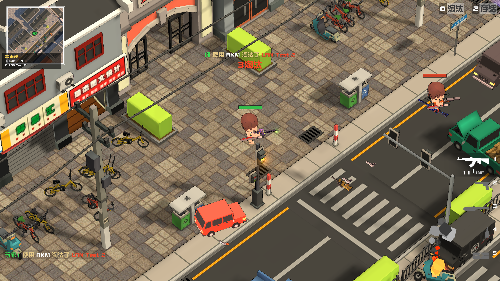

# Mini Battlegrounds Netplay

Mini Battlegrounds Netplay 是非官方的 Windows 多人联机恢复项目，围绕地图 102 提供独立的房间服务。可在局域网发现房间或直连，也可加入自行部署的公网服务器。支持 1–8 人、大厅准备、房主开局、回合设置、战斗、计分、复活和断线重连。

**当前不兼容 Steam 原版（App 658470）**。该发行版缺少地图 102。每位玩家需要合法持有包含地图 102 的兼容 Windows 客户端。本仓库提供源码、补丁工具和构建指南；原游戏、地图、Unity 程序集、素材、提取数据和预构建安装包均不随仓库分发。

## 最新版本：v1.0.0

[v1.0.0 — 房主自定义房间](https://github.com/Ash-Rise/mini-battlegrounds-netplay/releases/tag/lan-player-v1.0.0) 在现有联机玩法基础上加入房主设置：

- **人数上限**：房主可在大厅设置 2–8 人，受服务端可用槽位限制。
- **回合时长**：提供 30、60、120、300 秒选项，设置从下一局生效。
- **设置确认**：大厅显示服务端确认后的配置；对局进行中锁定修改，开局名单遵守人数上限。
- **大厅操作**：通过独立设置弹窗调整房间，保留准备、开局、改名和角色选择流程。

此 Release 提供版本说明与源码下载。安装与运行方法见下方及[构建指南](BUILDING.md)。

## 开始联机

1. 准备合法取得的兼容客户端，保留未修改的原版目录。
2. 按[构建指南](BUILDING.md)在 Windows 上生成本地 Mod 安装包。用 `ModSetup.exe` 指定原版及新安装目录。安装器在独立目录复制并打补丁，地图与皮肤数据从玩家自己的文件提取。
3. 从新目录运行 `Start Game.exe`。LAN 房主选择「创建局域网房间」，其他玩家选择「搜索局域网房间」或手动输入房主 IPv4。加入自行部署的公网房间时，手动输入服务器 IPv4。
4. 在大厅选角色和皮肤并准备，由房主开局。开始对局后，新玩家需要等本局结束再加入。

房主也可按[服务端构建和部署步骤](BUILDING.md#从源码运行服务端)运行 `server.py`。LAN 房间可离线使用，源码构建的启动器默认跳过更新检查。

## 构建与验收

Windows 构建需要 Python 3.11+、.NET Framework C# 编译器、Mono.Cecil 0.11.6 和合法兼容客户端。数据提取需要 UnityPy 和 NumPy。打包需要 PyInstaller。完整命令及输入目录见[构建指南](BUILDING.md)。

`python tests/run-all.py` 运行自动化回归。真实地图 102 的干净 Windows 安装、Unity GUI、长时间运行和跨机器断线恢复仍有未完成的验收项；单机测试结果不能替代双机及长期运行验证。

## 许可与声明

[MIT License](LICENSE) 适用于项目贡献者有权授权的原创代码和文档，包括原创的服务端、补丁工具、启动器、更新器、安装器和测试。原游戏、地图、程序集、素材及从原游戏生成的数据或含原游戏代码的补丁产物不在此授权范围内。

第三方组件按各自许可证分发。Mono.Cecil 见[随附声明](steam-install/MONO_CECIL_LICENSE.txt)。本项目与原游戏开发商和发行商没有官方关联。
